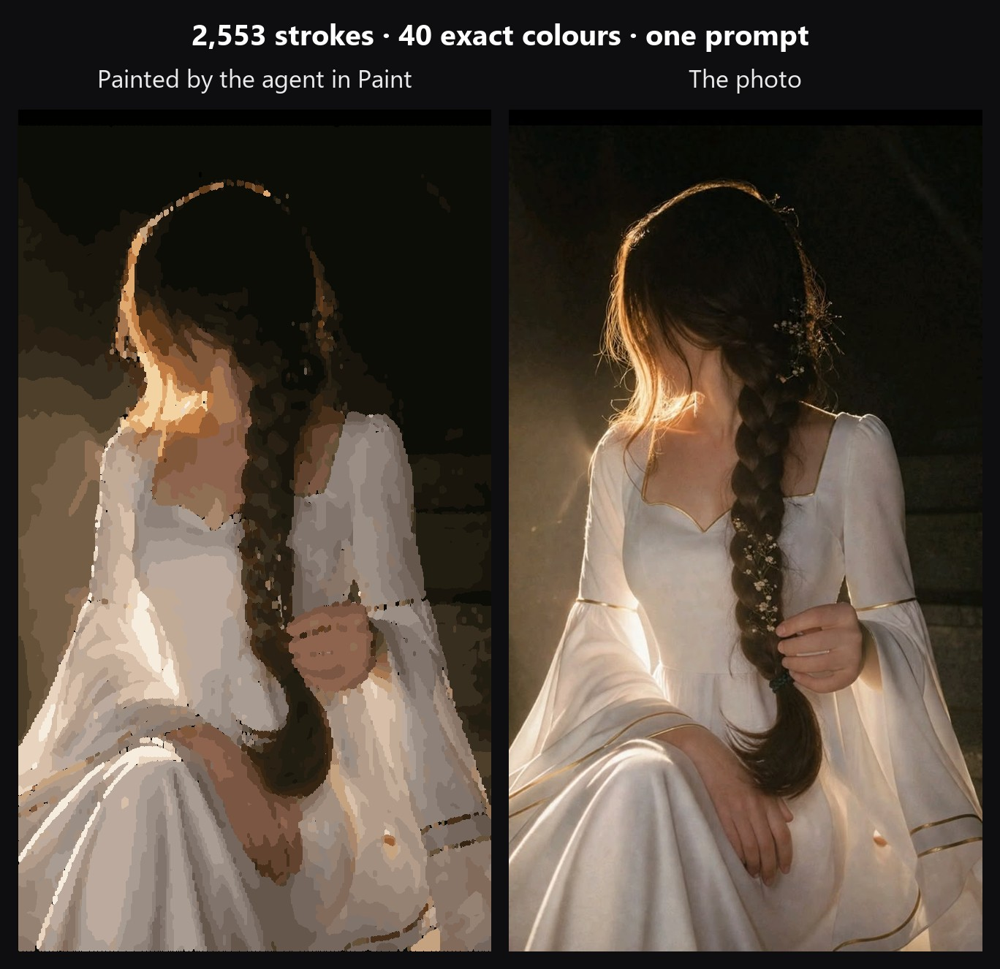
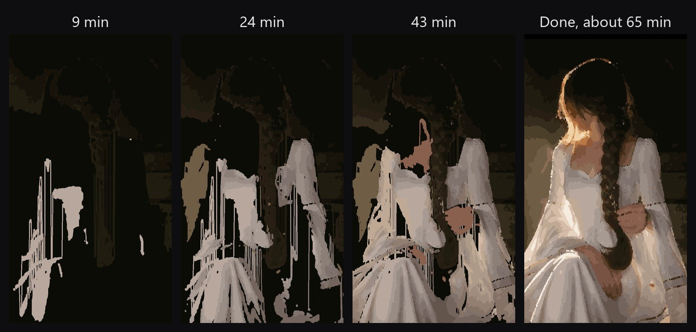

<h1 align="center">Antigravity Computer Use</h1>

<p align="center"><b>The computer use skill for Google Antigravity.</b><br>Your agent sees the screen and drives real apps on Windows and macOS: desktop automation with your real mouse and keyboard.</p>

<p align="center">
  <a href="https://github.com/shayann07/antigravity-computer-use/releases/latest"></a>
  
  <a href="LICENSE"></a>
  <a href="https://github.com/shayann07/antigravity-computer-use/stargazers"></a>
</p>

https://github.com/user-attachments/assets/67d22708-ac70-44bf-9570-acfd81f5a3ae

<p align="center">
  <b>/computer-use let Gemini 4 Hydrogen paint this in Microsoft Paint.</b><br>
  <sub>One prompt in Antigravity. The agent drove Paint through a stroke plan scripted from the photo: 2,553 strokes in 40 exact colours, about an hour of real painting, shown 200× faster.
  The bar and glow are drawn in, since they're hidden from screen recordings by default. <a href="#long-desktop-automation-jobs-in-one-command">How it was painted</a></sub>
</p>

<p align="center"><a href="#install"><b>Install</b></a>: a signed release for Windows and macOS, with SHA-256 checksums to verify before you run anything.</p>

Type `/computer-use` in Antigravity and say what you want done. The agent reads
the app, then clicks, types, drags and fills in dialogs with your real mouse and
keyboard. It uses the model you already have: no API key, no second LLM, no MCP
server.

## Install

Each [release](https://github.com/shayann07/antigravity-computer-use/releases/latest)
is signed and lists a SHA-256 for every archive in `SHA256SUMS.txt`. Check the
archive before you run anything from it.

**Windows.** Download `AntigravityComputerUse-<version>-windows-x64.zip` and
`SHA256SUMS.txt` from the latest release, then in PowerShell, in the download folder:

```powershell
$zip = Get-Item .\AntigravityComputerUse-*-windows-x64.zip
$want = ((Select-String -Path .\SHA256SUMS.txt -SimpleMatch $zip.Name).Line -split '\s+')[0]
(Get-FileHash $zip -Algorithm SHA256).Hash.ToLower() -eq $want   # must print True
Expand-Archive $zip -DestinationPath .
.\AntigravityComputerUse-windows-x64\install.cmd --integration direct --sidecar
```

**macOS.** Download the `macos-arm64` (Apple silicon) or `macos-x64` (Intel)
archive and `SHA256SUMS.txt`, then in Terminal, in the download folder:

```sh
shasum -a 256 -c SHA256SUMS.txt --ignore-missing   # must print OK
tar -xzf AntigravityComputerUse-*-macos-*.tar.gz
```

Run `macos-bundle/install.command`, then `Setup.Mac.Permissions.command`. [Mac guide](docs/MACOS.md)

**Windows, one line.** If you'd rather not do it by hand,
[install.ps1](install.ps1) downloads the same release and checks its SHA-256
before installing anything. Read it first if you like:

```powershell
irm https://raw.githubusercontent.com/shayann07/antigravity-computer-use/main/install.ps1 | iex
```

Then open Antigravity and try:

```text
/computer-use
Open Paint, draw a red circle in the middle, save it to my Desktop as circle.png.
```

## See what the agent is doing

<p align="center">
  <picture>
    <source media="(prefers-color-scheme: dark)" srcset="docs/media/glow-dark.png">
    
  </picture>
</p>

A soft glow outlines the window it is working in, and a small bar says what it
is doing right now.

<p align="center">
  
</p>

## Approvals before it touches any app

<p align="center">
  
</p>

Nothing runs without your OK: through Antigravity's own approvals with the
one-line install, or with this card in [standalone mode](docs/INSTALLATION.md#permission-policy),
where saving, pasting and deleting ask again. Terminals and code editors are
always click-only, so it can't type commands into them.

## One key stops computer use

<p align="center">
  
</p>

<kbd>Esc</kbd> stops it at once, wherever you are, and lets go of every key and
button. Ask it to carry on and it starts fresh. Sign-ins and admin prompts are
always left to you.

## Long desktop automation jobs in one command

`plan` sends many steps at once, so the model doesn't have to think between
every click. A 30-turn task drops to about 9.

The portrait at the top took one prompt. Gemini 4 Hydrogen ran a single `plan` of 2,832 steps that pick 40 exact colours in
Paint's colour editor and paint each one as long back-and-forth rows. It ran
unattended for about 65 minutes.

<p align="center">
  <a href="docs/media/paint-vs-photo.jpg"></a><br>
  <sub>Click to open full size.</sub>
</p>

<p align="center">
  
</p>

<p align="center">⭐ If that made you want to try it, <b>a star helps others find it.</b></p>

## Learn more

[Install guide](docs/INSTALLATION.md) · [Mac guide](docs/MACOS.md) ·
[Security](SECURITY.md) · [Changelog](CHANGELOG.md) ·
[Contributing](CONTRIBUTING.md)

MIT licensed. Not affiliated with Google.
Built on [ridelink0/claude-computer-use](https://github.com/ridelink0/claude-computer-use); see [UPSTREAM.json](UPSTREAM.json).
