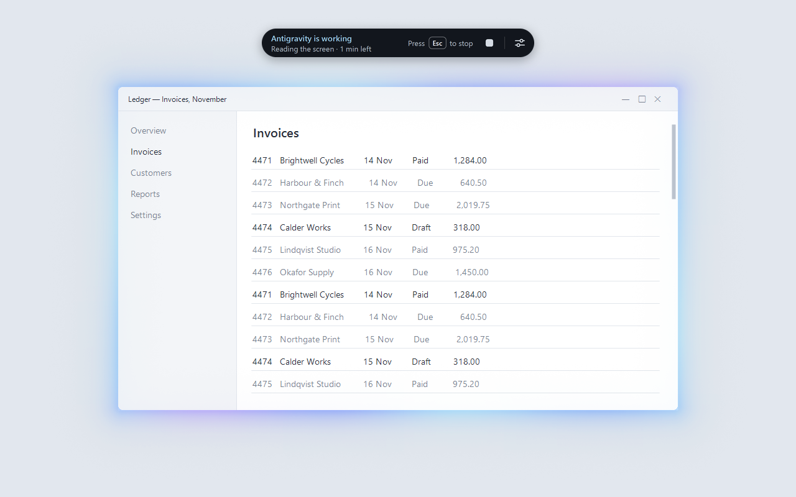

<h1 align="center">Antigravity Computer Use</h1>

<p align="center"><b>Let your Antigravity agent use real apps on Windows and macOS.</b></p>

<p align="center">
  <a href="https://github.com/shayann07/antigravity-computer-use/releases/latest"></a>
  
  <a href="LICENSE"></a>
</p>

<p align="center">
  
</p>

Type `/computer-use` in Antigravity and say what you want done. It reads the
app, clicks, types and drags with your real mouse and keyboard, and uses the
model you already have. No API key, no extra LLM, no MCP server.

## Install

**Windows**

```powershell
irm https://raw.githubusercontent.com/shayann07/antigravity-computer-use/main/install.ps1 | iex
```

**macOS:** download the `macos-arm64` (Apple silicon) or `macos-x64` (Intel)
archive from the [latest release](https://github.com/shayann07/antigravity-computer-use/releases/latest),
then run `install.command` and `Setup.Mac.Permissions.command`. [Mac guide](docs/MACOS.md)

## You're in charge

<p align="center">
  
</p>

It asks before touching any app. **Esc** stops it instantly, wherever you are.

## Links

[Install guide](docs/INSTALLATION.md) · [Mac guide](docs/MACOS.md) ·
[Security](SECURITY.md) · [Changelog](CHANGELOG.md) ·
[Contributing](CONTRIBUTING.md)

MIT licensed. Not affiliated with Google.
Built on [ridelink0/claude-computer-use](https://github.com/ridelink0/claude-computer-use); see [UPSTREAM.json](UPSTREAM.json).

<p align="center">⭐ <b>Star it if it saves you time.</b></p>
