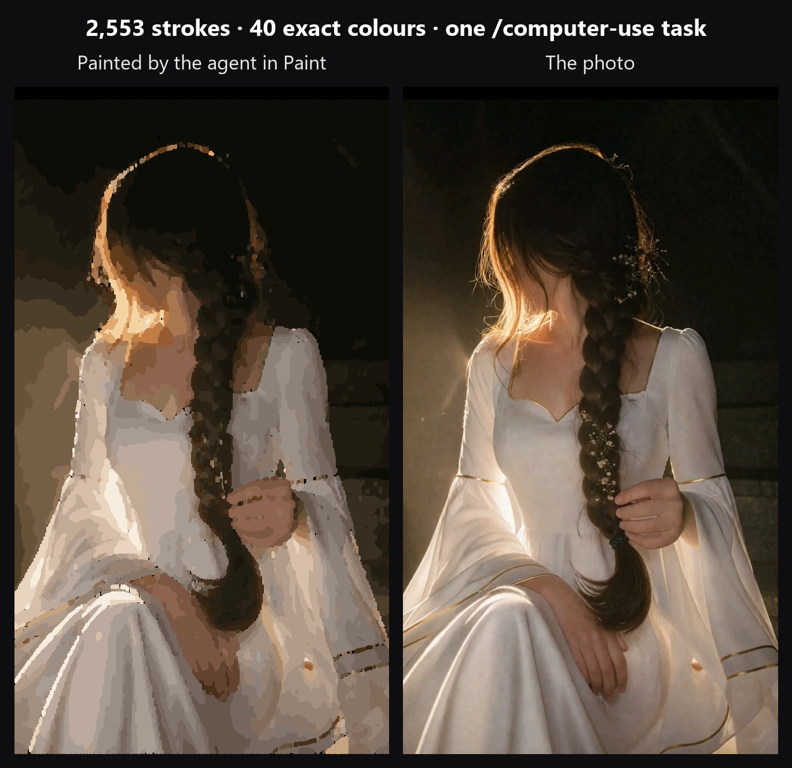
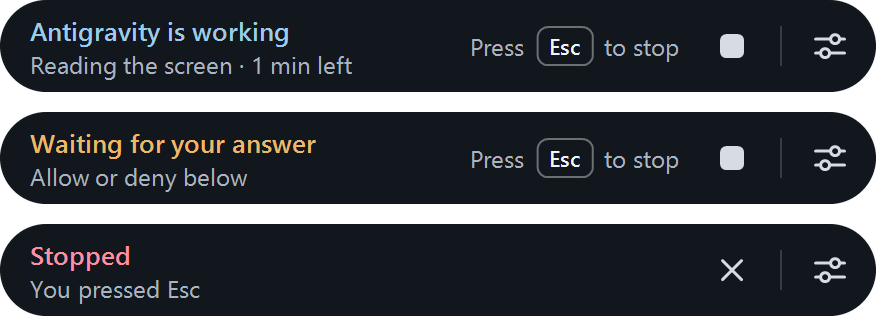
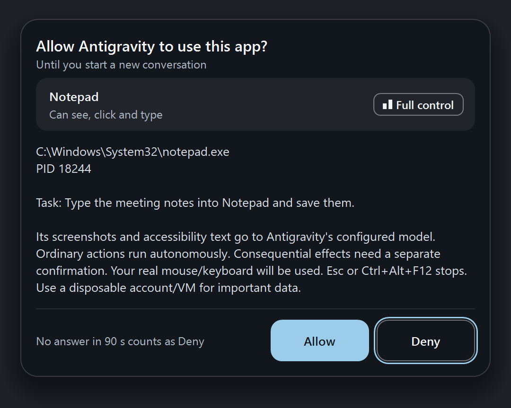
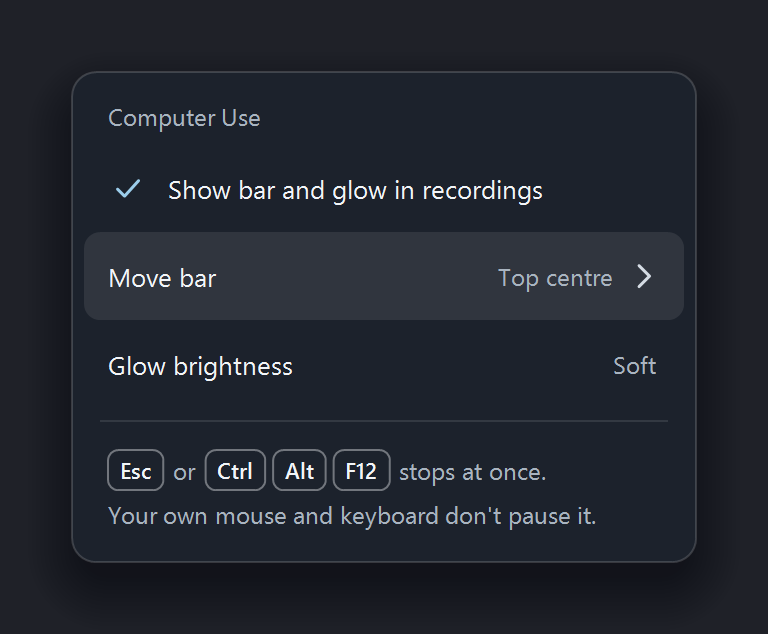
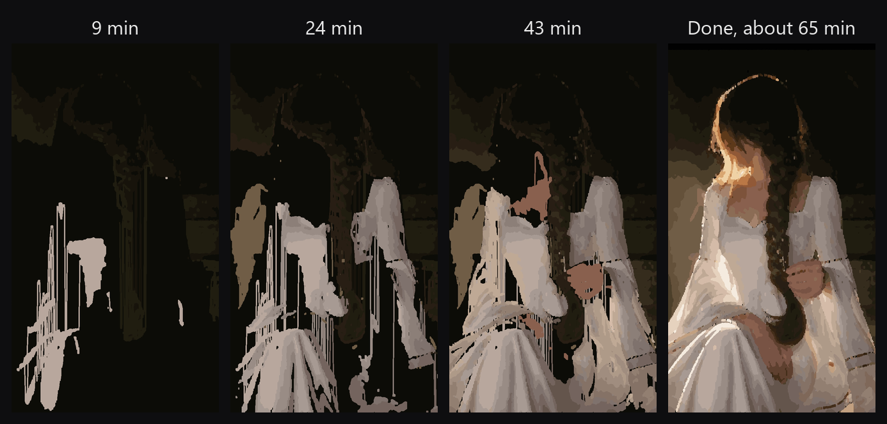

<h1 align="center">Antigravity Computer Use</h1>

<p align="center"><b>Let your Antigravity agent use real apps on Windows and macOS.</b></p>

<p align="center">
  <a href="https://github.com/shayann07/antigravity-computer-use/releases/latest"></a>
  
  <a href="LICENSE"></a>
  <a href="https://github.com/shayann07/antigravity-computer-use/stargazers"></a>
</p>

<p align="center">
  <a href="docs/media/paint-demo.mp4"></a>
</p>

<p align="center">
  <a href="docs/media/paint-demo.mp4"><b>▶ Watch it paint (21 s)</b></a><br>
  <sub>A real run: Antigravity drove Microsoft Paint through a prepared plan of 2,553 strokes in 40 exact colours. About an hour of painting, shown 260× faster.</sub>
</p>

Type `/computer-use` in Antigravity and say what you want done. The agent reads
the app, then clicks, types, drags and fills in dialogs with your real mouse and
keyboard. It uses the model you already have: no API key, no second LLM, no MCP
server.

## Install

**Windows**

```powershell
irm https://raw.githubusercontent.com/shayann07/antigravity-computer-use/main/install.ps1 | iex
```

**macOS:** download the `macos-arm64` (Apple silicon) or `macos-x64` (Intel)
archive from the [latest release](https://github.com/shayann07/antigravity-computer-use/releases/latest),
then run `install.command` and `Setup.Mac.Permissions.command`. [Mac guide](docs/MACOS.md)

Then open Antigravity and try:

```text
/computer-use
Open Paint, draw a red circle in the middle, save it to my Desktop as circle.png.
```

## You can see what it's doing

<p align="center">
  <picture>
    <source media="(prefers-color-scheme: dark)" srcset="docs/media/glow-dark.png">
    
  </picture>
</p>

A soft glow outlines the window it is working in, and a small bar says what it
is doing right now.

<p align="center">
  
</p>

## It asks before it touches anything

<p align="center">
  
</p>

Nothing runs without your OK: through Antigravity's own approvals with the
one-line install, or with this card in [standalone mode](docs/INSTALLATION.md#permission-policy),
where saving, pasting and deleting ask again. Terminals and code editors are
always click-only, so it can't type commands into them.

## One key stops it

<p align="center">
  
</p>

**Esc** stops it at once, wherever you are, and lets go of every key and
button. Ask it to carry on and it starts fresh. Sign-ins and admin prompts are
always left to you.

## Long jobs in one command

`plan` sends many steps at once, so the model doesn't have to think between
every click. A 30-turn task drops to about 9.

The portrait at the top is one `plan`: 2,832 steps that pick 40 exact colours in
Paint's colour editor and paint each one as long back-and-forth rows. It ran
unattended for about 65 minutes with no retries.

<p align="center">
  
</p>

## Learn more

[Install guide](docs/INSTALLATION.md) · [Mac guide](docs/MACOS.md) ·
[Security](SECURITY.md) · [Changelog](CHANGELOG.md) ·
[Contributing](CONTRIBUTING.md)

MIT licensed. Not affiliated with Google.
Built on [ridelink0/claude-computer-use](https://github.com/ridelink0/claude-computer-use); see [UPSTREAM.json](UPSTREAM.json).

<p align="center">⭐ <b>Star it if it saves you time.</b></p>
