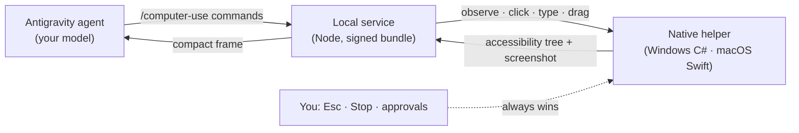

<h1 align="center">Antigravity Computer Use</h1>

<p align="center">
  <b>The computer use skill for Google Antigravity.</b><br>
  Your agent sees the screen and drives real Windows and Mac apps<br>
  with the real mouse and keyboard, and you can stop it with one key.
</p>

<p align="center">
  <a href="https://github.com/shayann07/antigravity-computer-use/releases/latest"></a>
  <a href="https://github.com/shayann07/antigravity-computer-use/actions/workflows/ci.yml"></a>
  
  
  <a href="LICENSE"></a>
  <a href="https://github.com/shayann07/antigravity-computer-use/stargazers"></a>
</p>

<p align="center">
  
</p>

<p align="center">
  <a href="#install"><b>Install</b></a> ·
  <a href="#try-it">Try it</a> ·
  <a href="#you-stay-in-control">Safety</a> ·
  <a href="#faq">FAQ</a> ·
  <a href="https://github.com/shayann07/antigravity-computer-use/releases/latest">Release notes</a>
</p>

Type **/computer-use** in Antigravity and describe the job. The agent looks at
the app, reads its buttons and fields through the operating system's
accessibility tree, and clicks, types, drags and fills in file dialogs like a
person would, on your real desktop. It uses the model you already picked in
Antigravity: no second LLM, no API key, no browser extension, no MCP server.

The recording above is real, edited for length: the agent operates Upscaly and
upscales a photo 4×. The countdown runs at 8× speed and is labelled.
[How it was made](docs/media/LAUNCH-FILM.md).

## Why this one

- **Real apps, not a sandbox.** Native accessibility first, screenshots where
  a canvas needs eyes. It works in apps that have no API.
- **Fast on long jobs.** `plan` sends many steps in one command, so a task that
  took 30 model turns now takes 9. A 177-step painting in Preview ran in one
  session with no retries.
- **You can always see it and stop it.** A soft edge glow marks the window it
  is working in, a control bar shows what it is doing, and Esc ends it at once.
- **It asks first.** Every new app needs your approval, and sensitive actions
  such as Save, Paste or Delete are confirmed separately.
- **Signed and verifiable.** Every release is signed through a protected
  environment, and installed copies update themselves only from signed
  metadata, with rollback.

## Install

**Windows** (x64): paste this into PowerShell.

```powershell
irm https://raw.githubusercontent.com/shayann07/antigravity-computer-use/main/install.ps1 | iex
```

It downloads the signed 1.0.0 bundle, checks its SHA-256, installs the skill
and enables a small background service that Antigravity starts for you. Your
existing settings are kept.

**macOS** (14 or later, Apple silicon or Intel): download
`AntigravityComputerUse-1.0.0-macos-arm64.tar.gz` (Apple silicon) or
`…-macos-x64.tar.gz` (Intel) from the
[latest release](https://github.com/shayann07/antigravity-computer-use/releases/latest),
extract it, run `install.command`, then run `Setup.Mac.Permissions.command` to
grant Accessibility and Screen Recording. Details in the [Mac guide](docs/MACOS.md).

Manual installs, project-only setup, updates and removal:
[installation guide](docs/INSTALLATION.md).

## Try it

```text
/computer-use
Open Paint, draw a red circle in the middle of the canvas, save it to my
Desktop as circle.png, and end computer use when finished.
```

Name the app, the file and where the result should go. The agent is faster
when it doesn't have to search.

## How it works



The agent reads a compact tree of the window and acts on elements by number,
so most steps need no screenshot at all. Every action is checked against a
fresh observation, and an input whose outcome is uncertain is never replayed.

| Capability | How it works |
| --- | --- |
| **See the app** | Accessibility names, roles and values, plus a screenshot when the task is visual. |
| **Use controls** | Click, invoke, select, toggle and set values on the elements it observed. |
| **Work visually** | The real cursor: click, double-click, right-click, drag strokes through many points, scroll. |
| **Type** | Native keyboard input, Unicode text, shortcuts, and paste that restores your clipboard. |
| **Work across apps** | Find, launch and focus windows; a launched app comes to the front before its first look. |
| **Run long plans** | Steps batched and checkpointed; a batch cut off mid-way is never sent twice. |

## You stay in control

- **Stop is always yours.** Esc, Ctrl+Alt+F12 or the bar's Stop button halts
  the agent, releases any held keys and buttons and ends the task. Tell it to
  continue and it starts fresh; apps you approved stay approved for that
  conversation.
- **You can see it working.** A soft blue glow around the window it is using
  and a control bar you can drag, throw or tuck into a corner.
- **Approvals are explicit.** Each app request shows the app, what its access
  tier allows ("Full control" or "Click only") and how long the approval lasts.
  Terminals and editors are click-only, so the agent can't type commands into
  them.
- **Human-only screens stay human.** Sign-ins, UAC and the secure desktop are
  handed back to you.
- **No telemetry.** Screenshots go only to the model provider you already use
  in Antigravity.

Use one desktop task at a time: a desktop has one mouse and keyboard.
[Security model](SECURITY.md) · [Permission policy](docs/INSTALLATION.md#permission-policy).

## Status

| Area | Where it stands (1.0.0) |
| --- | --- |
| **Windows** | Tested by hand on a real desktop: tasks, Esc while typing, Stop mid-flight, crash recovery, app launch and the control bar. |
| **macOS** | Tested by hand on a real Intel Mac: access cards, Esc and Stop, installation, and a 177-step drawing in Preview. Apple silicon is covered by CI on every change. |
| **Automated checks** | Windows and four macOS runners on every change. The local suite runs 722 tests with no failures. |
| **Releases** | Signed update metadata; signature, payload hashes and inventory verified against the public key before each release. |
| **Known limits** | Text-only models can't see screenshots, so visual tasks suffer ([#57](https://github.com/shayann07/antigravity-computer-use/issues/57)). Mixed-DPI multi-monitor setups are untested. Linux is not supported. |

[Validation record](VALIDATION.md) · [Performance notes](docs/PERFORMANCE.md) ·
[Changelog](CHANGELOG.md)

## FAQ

**Does it work with agents other than Antigravity?**
It is built and tested for Google Antigravity. The service is driven by a
plain command-line tool, so other agents that can run shell commands can call
it, but only Antigravity is supported today.

**Can it break my computer?**
It acts only in apps you approve, asks again for sensitive actions, and stops
the moment you press Esc. It never handles sign-ins or admin prompts.

**Is it slow?**
Most of the time in a long task is the model thinking between steps. `plan`
removes much of that by sending steps in batches.

**Does it phone home?**
No. It checks GitHub for signed updates, which you can switch to manual.

## Contribute

Issues and pull requests are welcome, especially ones that make real apps more
reliable or cut model turns. Start with
[`good first issue`](https://github.com/shayann07/antigravity-computer-use/labels/good%20first%20issue)
and read [CONTRIBUTING](CONTRIBUTING.md).

```powershell
git clone https://github.com/shayann07/antigravity-computer-use.git
cd antigravity-computer-use
npm test
npm run bundle
```

Windows builds need Node 24.20.0 and the built-in .NET Framework compiler;
Mac builds need Xcode Command Line Tools. There are no npm runtime dependencies.

## License and attribution

**MIT licensed.** Built on the MIT native implementation from
[ridelink0/claude-computer-use](https://github.com/ridelink0/claude-computer-use),
with attributed adaptations from OpenAI's and Anthropic's MIT computer-use
samples. Revisions and hashes are in [UPSTREAM.json](UPSTREAM.json); bundled
components are in [third-party notices](THIRD_PARTY_NOTICES.md).

An independent project, not affiliated with or endorsed by Google, OpenAI or
Anthropic.

<p align="center"><b>If it saves you time, a ⭐ helps others find it.</b></p>
